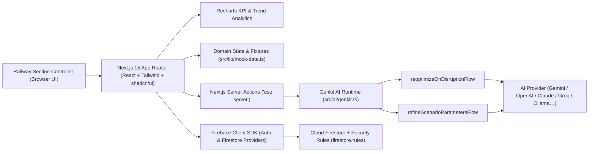

# RailFlow Optimizer

**Intelligent Decision-Support System for Indian Railways Train Traffic Control**

RailFlow Optimizer is a modern Next.js web application and AI decision-support workbench designed to help railway section controllers monitor live train movements, track network performance KPIs, simulate operational "what-if" scenarios, and rapidly generate disruption mitigation plans powered by Google Genkit with pluggable AI providers (Gemini, OpenAI, Anthropic, Groq, Ollama, and more).

---

## Table of Contents

- [Overview](#overview)
- [Key Features](#key-features)
- [System Architecture](#system-architecture)
- [Tech Stack](#tech-stack)
- [Project Structure](#project-structure)
- [Getting Started](#getting-started)
  - [Prerequisites](#prerequisites)
  - [Installation](#installation)
  - [Environment Configuration](#environment-configuration)
  - [Running Locally](#running-locally)
- [AI Flows & Genkit Studio](#ai-flows--genkit-studio)
- [Database & Security Rules](#database--security-rules)
- [Available Scripts](#available-scripts)
- [Documentation](#documentation)
- [Contributing](#contributing)
- [Security](#security)
- [License](#license)

---

## Overview

Managing high-density rail corridors requires rapid, conflict-free decisions across express passenger services, suburban locals, and freight trains. **RailFlow Optimizer** provides a unified control-room interface tailored for Indian Railways workflows:

- **Situational Awareness:** Centralized dashboard tracking punctuality, average delay, network throughput, and track utilization.
- **Disruption Mitigation:** Log active network incidents (breakdowns, weather restrictions, scheduled maintenance) and trigger AI-generated re-optimization plans.
- **What-If Simulation:** Test contingency scenarios—such as engine failure, signal failure, derailment, medical emergency, or rerouting—and refine operational parameters using AI before applying changes.
- **Accountability:** Chronological audit trail logging controller actions and automated system recommendations.

> **Current Implementation Scope:** The dashboard visualizations, train status monitor, disruption log, and audit trail use domain sample data (`src/lib/mock-data.ts`) for interactive demonstration, while the AI workflows execute live server-side calls via Genkit + Google Gemini. Firebase Auth, Firestore client hooks, entity schemas (`docs/backend.json`), and security rules (`firestore.rules`) are scaffolded for backend persistence.

---

## Key Features

| Module | Route | Capabilities |
| :--- | :--- | :--- |
| **Executive Dashboard** | `/dashboard` | Displays 4 operational KPI cards (`Overall Punctuality`, `Average Delay`, `Network Throughput`, `Track Utilization`), a vertical stacked bar chart (*Punctuality by Train Type*), and a 7-day *Average Delay Trend* line chart. |
| **What-If Scenario Simulation** | `/dashboard/scenarios` | Guided scenario builder covering 8 operational events (`Engine Failure`, `Track Maintenance`, `Signal Failure`, `Derailment`, `Medical Emergency`, `Security Threat`, `Reroute a Train`, `Reschedule a Train`) with Genkit AI refinement returning crisp controller commands and strategic reasoning. |
| **Live Train Status** | `/dashboard/trains` | Real-time style network monitoring table with train ID, name, service type (`Express`, `Local`, `Freight`), priority badges, operational status (`On Time`, `Delayed`, `Halted`, `Rerouted`), delay duration, current location, and next station. |
| **Disruption Management** | `/dashboard/disruptions` | Incident log categorized by `Breakdown`, `Weather`, and `Maintenance`, form-validated *Report New Disruption* modal (`react-hook-form` + `zod`), and one-click **Re-Optimize** AI schedule generation for active incidents. |
| **Audit Trail** | `/dashboard/audit` | Chronological log of controller overrides (e.g., *Halt Train*, *Priority Override*) and automated `SYSTEM` suggestions. |
| **Settings & Theme** | `/dashboard/settings` | Controller profile management (`Controller A`, `NDLS Division`), dark/light mode toggle (`next-themes`), and system alert preferences. |
| **Controller Sign-In** | `/login` | Authentication UI styled around Indian Railways operations (currently routes directly to `/dashboard` in demo mode). |

---

## System Architecture



For a deeper technical breakdown—including Zod schemas, Firestore collections, and UI design tokens—see [docs/ARCHITECTURE.md](docs/ARCHITECTURE.md).

---

## Tech Stack

- **Frontend Framework:** [Next.js 15](https://nextjs.org/) (App Router, Turbopack), [React 18](https://react.dev/), [TypeScript 5](https://www.typescriptlang.org/)
- **Styling & Design System:** [Tailwind CSS](https://tailwindcss.com/), [shadcn/ui](https://ui.shadcn.com/) ([Radix UI](https://www.radix-ui.com/) primitives), [Lucide Icons](https://lucide.dev/), `next-themes`
- **Data Visualization:** [Recharts](https://recharts.org/)
- **Forms & Validation:** [React Hook Form](https://react-hook-form.com/), [Zod](https://zod.dev/)
- **AI Orchestration:** [Firebase Genkit](https://firebase.google.com/docs/genkit) (`genkit`, `@genkit-ai/googleai`, `@genkit-ai/next`) with pluggable provider support (Google Gemini, OpenAI, Anthropic, Groq, Ollama, and any OpenAI-compatible endpoint)
- **Backend & Hosting Infrastructure:** [Firebase SDK](https://firebase.google.com/) (Auth & Firestore hooks), Firebase App Hosting (`apphosting.yaml`), Firestore Security Rules (`firestore.rules`)

---

## Project Structure

```text
.
├── docs/
│   ├── ARCHITECTURE.md               # Technical architecture, schemas, and design tokens
│   ├── backend.json                  # Firestore entity and collection blueprint
│   └── blueprint.md                  # Product specification and style guidelines
├── src/
│   ├── ai/
│   │   ├── dev.ts                    # Genkit developer server entrypoint
│   │   ├── genkit.ts                 # Genkit + Google AI plugin configuration
│   │   └── flows/
│   │       ├── reoptimize-on-disruption.ts     # AI disruption mitigation server action
│   │       └── what-if-scenario-refinement.ts  # AI scenario parameter refinement action
│   ├── app/
│   │   ├── globals.css               # Theme variables (Indian Saffron, Deep Teal, Dark mode)
│   │   ├── layout.tsx                # Root layout with FirebaseClientProvider & ThemeProvider
│   │   ├── page.tsx                  # Root redirect to /dashboard
│   │   ├── login/page.tsx            # Controller login screen
│   │   └── dashboard/
│   │       ├── layout.tsx            # Sidebar + Header shell
│   │       ├── page.tsx              # KPI cards & performance charts
│   │       ├── audit/page.tsx        # Decision & action audit log
│   │       ├── disruptions/page.tsx  # Disruption log, reporting modal, & AI re-optimization
│   │       ├── scenarios/page.tsx    # What-if scenario simulation page
│   │       ├── settings/page.tsx     # Profile, theme toggle, & alert settings
│   │       └── trains/page.tsx       # Live train status monitoring table
│   ├── components/
│   │   ├── dashboard/                # KPI cards, PunctualityChart, DelayChart
│   │   ├── layout/                   # AppSidebar and Header components
│   │   ├── scenarios/                # WhatIfForm multi-scenario builder
│   │   ├── ui/                       # Reusable shadcn/ui components
│   │   └── FirebaseErrorListener.tsx # Global Firestore permission error listener
│   ├── firebase/
│   │   ├── config.ts                 # Firebase project configuration
│   │   ├── index.ts                  # Firebase SDK initialization & barrel exports
│   │   ├── provider.tsx              # React context & hooks (useFirebase, useUser, etc.)
│   │   ├── client-provider.tsx       # Client-side Firebase provider wrapper
│   │   ├── non-blocking-login.tsx    # Non-blocking Firebase Auth helpers
│   │   ├── non-blocking-updates.tsx  # Non-blocking Firestore write helpers
│   │   ├── error-emitter.ts          # Typed event emitter for Firestore errors
│   │   ├── errors.ts                 # Structured FirestorePermissionError class
│   │   └── firestore/                # Real-time useCollection & useDoc hooks
│   ├── hooks/                        # Custom React hooks (use-mobile, use-toast)
│   └── lib/
│       ├── mock-data.ts              # Sample Indian Railways KPIs, trains, disruptions, logs
│       ├── types.ts                  # TypeScript types & Zod AI flow schemas
│       └── utils.ts                  # Tailwind class merging utility (cn)
├── .env.example                      # Environment variable template
├── apphosting.yaml                   # Firebase App Hosting runtime config
├── components.json                   # shadcn/ui configuration
├── firestore.rules                   # Firestore access control rules
├── next.config.ts                    # Next.js configuration
├── package.json                      # Project scripts and dependencies
└── tailwind.config.ts                # Tailwind theme extensions & font mappings
```

---

## Getting Started

### Prerequisites

- **Node.js:** `v20.x` or newer (tested on Node `v22.x`)
- **npm:** `v10.x` or newer
- **AI Provider API Key:** Required to run the Genkit AI flows (`/dashboard/scenarios` and `/dashboard/disruptions`). Any of the following work — pick one:
  - **Google Gemini** (free tier available) → [Google AI Studio](https://aistudio.google.com/)
  - **OpenAI** → [platform.openai.com](https://platform.openai.com/api-keys)
  - **Anthropic Claude** → [console.anthropic.com](https://console.anthropic.com/)
  - **Groq / Mistral / Together AI** → OpenAI-compatible endpoints
  - **Ollama (local, free)** → [ollama.com](https://ollama.com/)

### Installation

1. **Clone the repository:**

   ```bash
   git clone https://github.com/<your-username>/<your-repo-name>.git
   cd <your-repo-name>
   ```

2. **Install dependencies:**

   ```bash
   npm install
   ```

### Environment Configuration

1. Copy the example environment file:

   ```bash
   cp .env.example .env.local
   ```

   *(On Windows PowerShell: `Copy-Item .env.example .env.local`)*

2. Open `.env.local` and supply your AI provider key (pick **one** — see `.env.example` for all options):

   ```env
   # Google Gemini
   GEMINI_API_KEY=your_gemini_api_key_here

   # — OR — OpenAI
   OPENAI_API_KEY=your_openai_api_key_here

   # — OR — OpenAI-compatible (Groq, Mistral, Ollama…)
   OPENAI_API_KEY=your_provider_key_here
   OPENAI_BASE_URL=https://api.groq.com/openai/v1

   # — OR — Anthropic Claude
   ANTHROPIC_API_KEY=your_anthropic_api_key_here
   ```

   > **Note:** Never commit `.env` or `.env.local` files to version control. They are excluded by `.gitignore`.

### Running Locally

Start the Next.js development server (with Turbopack):

```bash
npm run dev
```

Open [http://localhost:3000](http://localhost:3000) in your browser:

- **Dashboard:** `http://localhost:3000/dashboard`
- **What-If Scenarios:** `http://localhost:3000/dashboard/scenarios`
- **Live Trains:** `http://localhost:3000/dashboard/trains`
- **Disruptions:** `http://localhost:3000/dashboard/disruptions`
- **Audit Trail:** `http://localhost:3000/dashboard/audit`
- **Settings:** `http://localhost:3000/dashboard/settings`
- **Login:** `http://localhost:3000/login`

---

## AI Flows & Genkit Studio

RailFlow Optimizer uses two server-side Genkit flows. The AI provider is resolved automatically from your environment variables (see `.env.example`):

1. **`reoptimizeOnDisruption`** (`src/ai/flows/reoptimize-on-disruption.ts`)
   - **Inputs:** Active `disruption` object, array of active `trains`, and `optimizationGoals`.
   - **Outputs:** Bullet-formatted `reoptimizationSuggestions` and concise `reasoning`.
2. **`refineScenarioParameters`** (`src/ai/flows/what-if-scenario-refinement.ts`)
   - **Inputs:** Structured `scenarioDescription`, `currentKpis`, and `optimizationGoals`.
   - **Outputs:** Up to 3 crisp, controller-ready `refinedParameters` commands and a brief `reasoning` summary.

To inspect and test the Genkit flows locally using the Genkit Developer UI:

```bash
npm run genkit:dev
# or with hot-reload:
npm run genkit:watch
```

---

## Database & Security Rules

Firestore collections and authorization policies are defined in [`docs/backend.json`](docs/backend.json) and [`firestore.rules`](firestore.rules):

- **`/users/{userId}`:** Strictly private owner-only read/write access (`request.auth.uid == userId`).
- **`/trains`, `/sections`, `/stations`, `/stations/{stationId}/platforms`, `/timetables`, `/disruptions`, `/audit_logs`:** Publicly readable operational entities with client-side writes locked down (`allow create, update, delete: if false;`) to enforce trusted server-side or admin updates.
- **`/roles_admin/{userId}`:** Database-based access control (DBAC) marker collection.

---

## Available Scripts

| Command | Description |
| :--- | :--- |
| `npm run dev` | Starts Next.js development server with Turbopack. |
| `npm run build` | Builds the production bundle (`next build`). |
| `npm run start` | Starts the production Next.js server after building. |
| `npm run lint` | Runs Next.js ESLint setup/checks (`next lint`; prompts for ESLint setup if `.eslintrc.json` is not configured). |
| `npm run typecheck` | Runs TypeScript static type checking (`tsc --noEmit`). |
| `npm run genkit:dev` | Launches the Genkit developer UI and flow runtime. |
| `npm run genkit:watch` | Launches Genkit developer UI with file watching enabled. |

---

## Documentation

- [Product Blueprint](docs/blueprint.md) — Core features and Indian Railways-inspired UI style guide.
- [System Architecture](docs/ARCHITECTURE.md) — Detailed technical overview, AI schemas, and data modeling.
- [Backend Schema](docs/backend.json) — JSON Schema specifications for Firestore entities.
- [Firestore Rules](firestore.rules) — Security rules governing client and server access.

---

## Contributing

Contributions are welcome! Please review [CONTRIBUTING.md](CONTRIBUTING.md) before opening a pull request or submitting an issue.

---

## Security

Please review [SECURITY.md](SECURITY.md) for environment variable handling, Firebase security notes, and vulnerability reporting guidelines.

---

## License

This project is licensed under the MIT License — see the [LICENSE](LICENSE) file for details.
