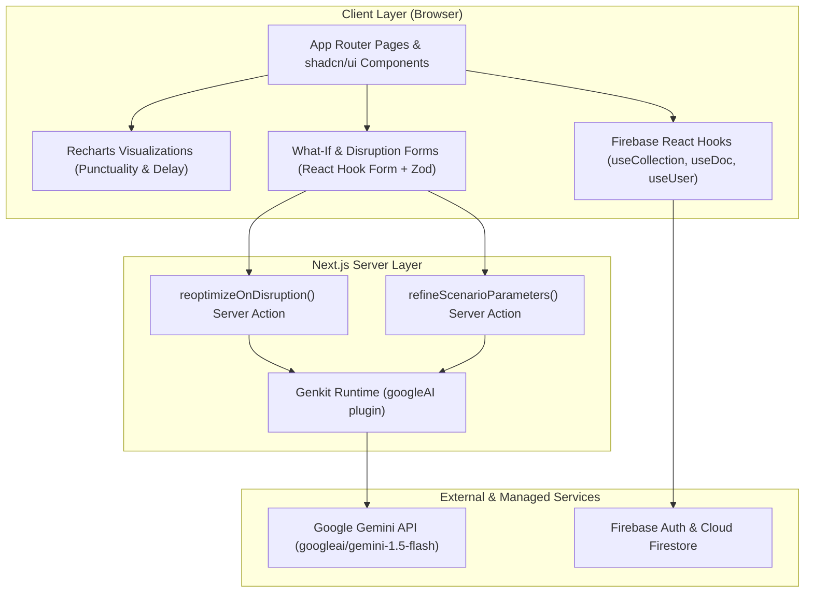
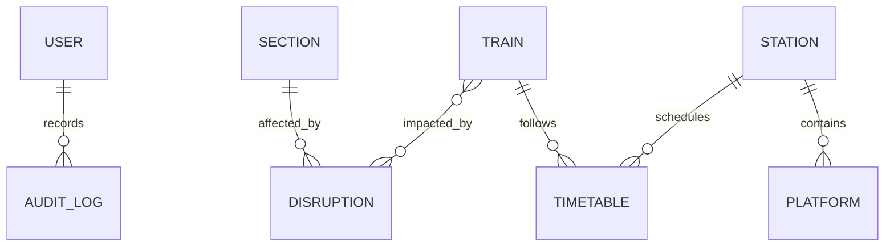

# System Architecture — RailFlow Optimizer

This document describes the technical architecture, AI integration, data modeling, and UI design system of **RailFlow Optimizer**.

---

## 1. High-Level Architecture

RailFlow Optimizer is built on the **Next.js 15 App Router** architecture combining client-interactive operational views with React Server Actions for generative AI inference.

---

## 2. Frontend & UI Design System

The interface is designed around a high-contrast control-room aesthetic inspired by Indian Railways:

- **Color Tokens** (`src/app/globals.css`, `docs/blueprint.md`):
  - **Primary (Indian Saffron):** `hsl(30 100% 60%)` (`#FF9933`)
  - **Accent (Deep Teal):** `hsl(180 100% 25%)` (`#008080`)
  - **Light Surface:** `hsl(36 33% 98%)` (`#FAF9F6`)
  - **Dark Surface (Default):** `hsl(240 10% 3.9%)`
- **Typography** (`src/app/layout.tsx`, `tailwind.config.ts`):
  - **Headlines:** `Playfair Display` (`font-headline`)
  - **Body Copy:** `PT Sans` (`font-body`)
- **Component Library:** Built using `shadcn/ui` primitives in `src/components/ui/` backed by `@radix-ui/*` and `lucide-react`.

---

## 3. AI Decision-Support Layer (`src/ai/`)

All LLM interactions are encapsulated behind `"use server"` functions and strongly typed using `zod` schemas in `src/lib/types.ts`.

### 3.1 Genkit Configuration (`src/ai/genkit.ts`)
- Registers the `@genkit-ai/googleai` plugin (`googleAI()`).
- Sets the default model to `googleai/gemini-1.5-flash`.
- Reads `GEMINI_API_KEY` or `GOOGLE_GENAI_API_KEY` from server environment variables.

### 3.2 Flow 1: Disruption Re-Optimization (`src/ai/flows/reoptimize-on-disruption.ts`)
- **Trigger:** Clicking **Re-Optimize** on any `Active` incident in `/dashboard/disruptions`.
- **Input (`ReoptimizationInputSchema`):**
  - `disruption`: `{ id, type, location, description, reportedAt, status }`
  - `trains`: Array of active `Train` objects (`id`, `name`, `type`, `priority`, `status`, `currentLocation`, `delay`, `nextStation`, `eta`)
  - `optimizationGoals`: String describing traffic priorities
- **Output (`ReoptimizationOutputSchema`):**
  - `reoptimizationSuggestions`: Newline-separated bullet list of immediate operational actions
  - `reasoning`: Concise explanation of the mitigation strategy

### 3.3 Flow 2: What-If Scenario Refinement (`src/ai/flows/what-if-scenario-refinement.ts`)
- **Trigger:** Submitting the Scenario Builder form in `/dashboard/scenarios` (`src/components/scenarios/what-if-form.tsx`).
- **Supported Scenario Types:**
  - `engine-failure`
  - `track-maintenance`
  - `signal-failure`
  - `derailment`
  - `medical-emergency`
  - `security-threat`
  - `reroute-train`
  - `reschedule-train`
- **Input (`RefineScenarioParametersInputSchema`):**
  - `scenarioDescription`: Dynamically constructed scenario prompt based on selected train, track section, duration, route, or departure time
  - `currentKpis`: Snapshot string of network punctuality, average delay, and track utilization
  - `optimizationGoals`: Controller-specified objectives
- **Output (`RefineScenarioParametersOutputSchema`):**
  - `refinedParameters`: Up to 3 concise one-line controller commands
  - `reasoning`: Single-sentence strategic justification

---

## 4. Data & Firebase Architecture

### 4.1 Domain Entities (`docs/backend.json` & `firestore.rules`)

### 4.2 Client Firebase Layer (`src/firebase/`)
- `initializeFirebase()` initializes the Firebase App (supporting automatic Firebase App Hosting config in production with `firebaseConfig` fallback in development).
- `FirebaseProvider` (`src/firebase/provider.tsx`) exposes `useAuth()`, `useFirestore()`, `useFirebaseApp()`, `useUser()`, and `useMemoFirebase()`.
- `useCollection` and `useDoc` (`src/firebase/firestore/`) subscribe to real-time Firestore snapshots and forward permission errors through `errorEmitter` to `FirebaseErrorListener`.
- Currently, dashboard pages render sample fixtures from `src/lib/mock-data.ts` so the entire interface can be evaluated locally without requiring live Firestore seed data.

